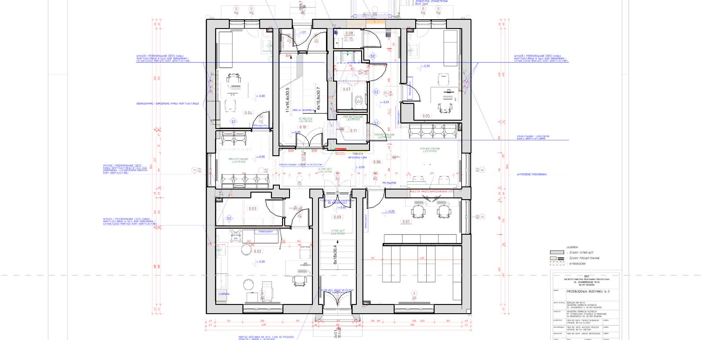
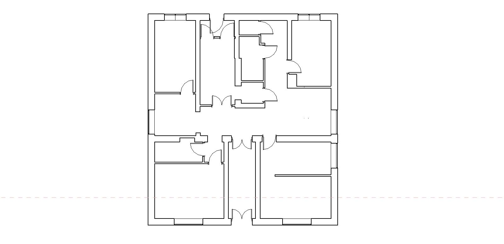
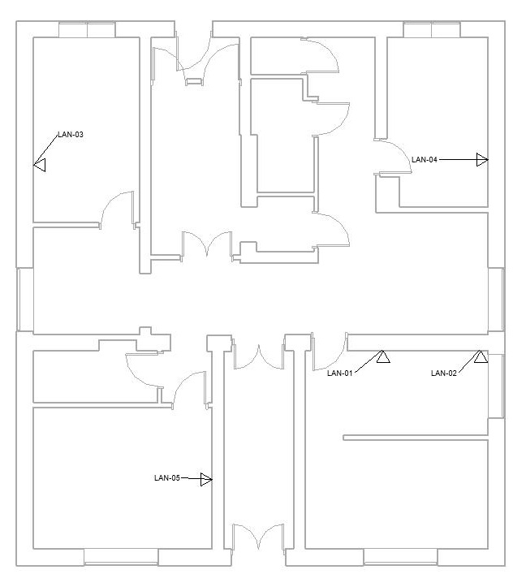
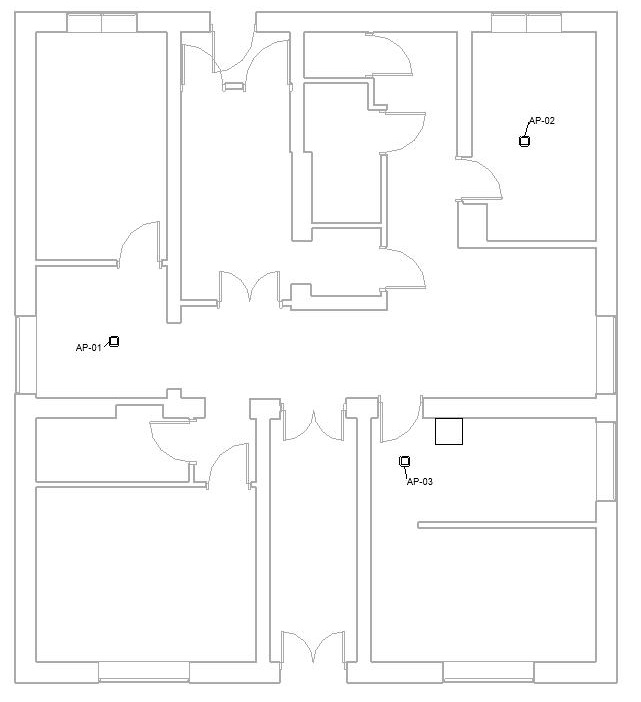
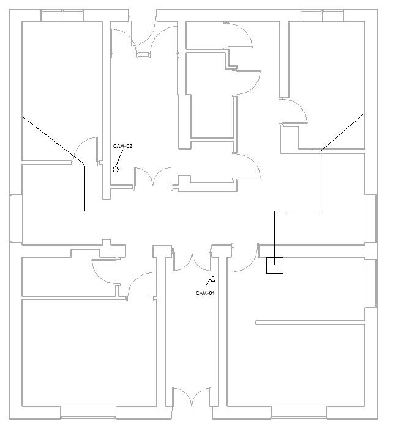

# Projekt instalacji teletechnicznych: przychodnia AGH

Projekt koncepcyjny wybranych instalacji teletechnicznych na parterze przychodni AGH U-3, opracowywany w **Autodesk Revit** na podstawie rzutu architektonicznego udostępnionego w materiałach przetargowych AGH. Obejmuje model architektoniczny oraz rozmieszczenie gniazd **LAN**, punktów dostępowych **Wi-Fi** i kamer **CCTV**, bez projektowania tras kablowych, zasilania i wyposażenia punktu dystrybucyjnego oraz doboru urządzeń aktywnych.

## 1. Model architektoniczny

Model architektoniczny przygotowano jako podkład do rozmieszczenia urządzeń teletechnicznych.

* **Dokument źródłowy:** [rzut parteru przychodni AGH U-3, rysunek 03A](zrodla/03A_Rzut_Parteru_Przychodnia_U-3.pdf).
* **Zakres modelowania:** ściany, drzwi i okna.
* **Metoda:** wczytano podkład PDF i dopasowano jego skalę do wymiarów na rysunku. Geometrię budynku odtworzono na jego podstawie zgodnie z podanymi wymiarami.
* **Uproszczenia:** model przedstawia główne elementy budynku. Nie odwzorowuje wszystkich detali konstrukcyjnych i wykończeniowych ani istniejących instalacji.

<table>
  <tr>
    <td align="center">
      
       Model parteru przychodni AGH U-3 z widocznym podkładem PDF
    </td>
    <td align="center">
      
       Model parteru przychodni AGH U-3 bez widocznego podkładu PDF
    </td>
  </tr>
</table>

## 2. Sieć LAN

Instalację LAN zaplanowano dla pięciu stanowisk komputerowych wskazanych na [rzucie architektonicznym](zrodla/03A_Rzut_Parteru_Przychodnia_U-3.pdf).

* **Liczba punktów:** 5.
* **Oznaczenia punktów:** LAN-01, LAN-02, LAN-03, LAN-04 i LAN-05.
* **Wyposażenie punktu:** 2 × RJ45 kategorii 6A.
* **Łączna liczba portów:** 10.
* **Rozmieszczenie:** gniazda umieszczono blisko stanowisk pracy, aby ograniczyć długość przewodów przyłączeniowych.
* **Wysokość w modelu:** 300 mm powyżej poziomu L1, oznaczającego poziom parteru. Dostęp do gniazd pod ladą recepcji należy sprawdzić po uwzględnieniu zabudowy meblowej.
* **Założenie połączeń:** do każdego portu przewidziano osobny kabel czteroparowy prowadzący do punktu dystrybucyjnego.

### Zestawienie punktów LAN

| Punkt | Lokalizacja |
|---|---|
| LAN&#8209;01 | 0.01, recepcja, pierwsze stanowisko przy ladzie. |
| LAN&#8209;02 | 0.01, recepcja, drugie stanowisko przy ladzie. |
| LAN&#8209;03 | 0.04, gabinet, stanowisko przy biurku. |
| LAN&#8209;04 | 0.05, gabinet, stanowisko przy biurku. |
| LAN&#8209;05 | 0.02, gabinet zabiegowy, stanowisko komputerowe. |

### Podstawa przyjętych rozwiązań

Rozmieszczenie punktów LAN oparto na układzie stanowisk oraz wybranych zapisach wycofanej normy PN-EN 50173-1:2004, wykorzystanej jako materiał pomocniczy.

* **Punkt 4.7.5.1 a:** każdy indywidualny obszar roboczy powinien być obsługiwany przez co najmniej dwa gniazda telekomunikacyjne.
* **Punkt 4.7.5.1 d:** każde gniazdo powinno mieć stały opis widoczny dla użytkownika.
* **Punkt 4.7.5.2 a:** zaleca się umieszczanie zestawu gniazd w miejscu dostępnym dla użytkownika.

### Rzut punktów LAN

  

## 3. Sieć Wi-Fi

Wstępne rozmieszczenie punktów dostępowych ma zapewnić dostęp bezprzewodowy w wybranych pomieszczeniach i przestrzeniach wspólnych.

* **Liczba punktów dostępowych:** 3.
* **Oznaczenia:** AP-01, AP-02 i AP-03.
* **Podstawa rozmieszczenia:** układ pomieszczeń i położenie przegród budowlanych.
* **Dalsza weryfikacja:** sprawdzenie liczby i lokalizacji punktów dostępowych z uwzględnieniem zasięgu, tłumienia przegród, liczby użytkowników i parametrów urządzeń oraz możliwości doprowadzenia okablowania i zasilania i zapewnienia dostępu serwisowego.

### Zestawienie punktów dostępowych

| Punkt | Lokalizacja |
|---|---|
| AP&#8209;01 | 0.06, korytarz. |
| AP&#8209;02 | 0.05, gabinet. |
| AP&#8209;03 | 0.01, recepcja. |

### Rzut punktów dostępowych

  

## 4. Kamery CCTV

Kamery rozmieszczono wstępnie do obserwacji stref wejściowych przychodni, uwzględniając układ ciągów komunikacyjnych.

* **Liczba kamer:** 2.
* **Oznaczenia:** CAM-01 i CAM-02.
* **Dalsza weryfikacja:** dobór kierunków obserwacji, pola widzenia i parametrów kamer z uwzględnieniem oświetlenia, przeszkód oraz wymaganej szczegółowości obrazu.

### Zestawienie kamer

| Kamera | Lokalizacja |
|---|---|
| CAM&#8209;01 | Korytarz przy dolnym wejściu na rzucie. |
| CAM&#8209;02 | Korytarz w pobliżu górnego wejścia na rzucie. |

### Rzut rozmieszczenia kamer

  

